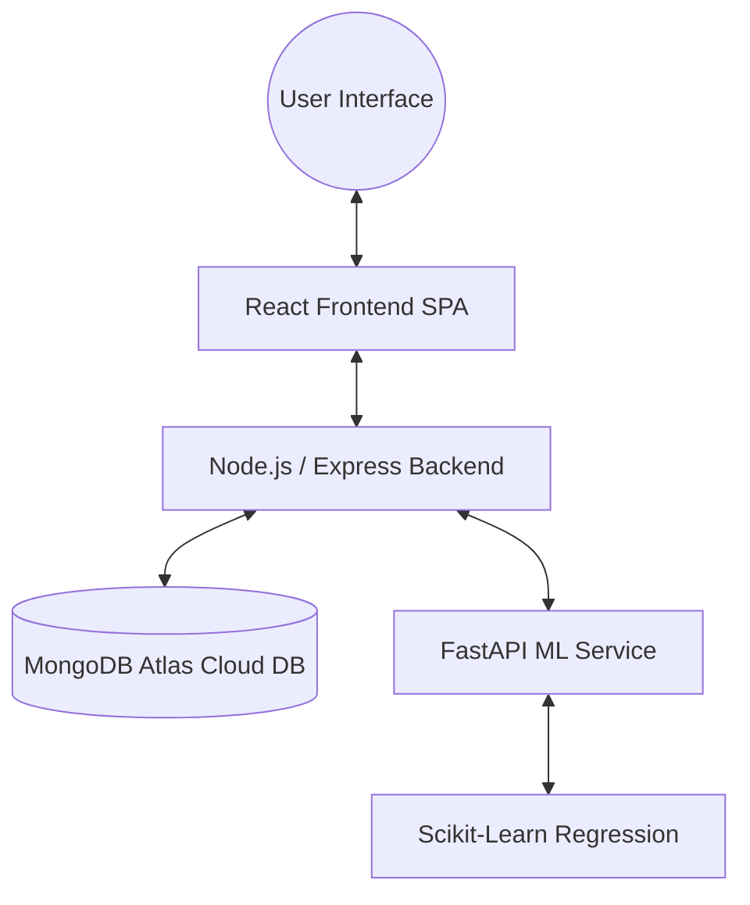

🛠️ How to Start Them in the Future
1. Start the ML Service
bash
cd ml-service
source venv/bin/activate
python -m uvicorn app:app --port 8001 --reload
(If port 8000 is free on your machine, you can run on --port 8000 as well).

2. Start the Backend
bash
cd backend
npm run dev

3. Start the Frontend (if needed)
bash
cd frontend
npm run dev


# SmartERP AI — Intelligent Inventory & Demand Forecasting Documentation

SmartERP AI is a state-of-the-art "Mini ERP" system that uses Machine Learning to optimize supply chain management, predict customer demand, and streamline inventory control. The project is designed with a decoupled architecture, dividing tasks among a React frontend, an Express/TypeScript backend database controller, and a FastAPI python service for machine learning models.

---

## 1. System Architecture

The application comprises three major service layers, separating user interface, business logic, data storage, and compute-heavy intelligence.



### Component Breakdown
*   **React Frontend (`/frontend`)**: A React 19 + TypeScript frontend application built on Vite and styled using TailwindCSS. It provides a dark-themed dashboard presenting historical sales vs. AI predictions, inventory reorder recommendations, product catalog management, and order logs.
*   **Node.js Backend (`/backend`)**: An Express framework API server written in TypeScript. It uses Prisma ORM to interact with MongoDB Atlas, runs background data-generation workers (via `node-cron`), manages transactional order processing, and orchestrates requests between the frontend and the Python ML service.
*   **ML Service (`/ml-service`)**: A Python-based FastAPI server that uses `pandas`, `numpy`, and `scikit-learn` to process historical sales timelines and run on-the-fly Linear Regression models to output future demand trends.

---

## 2. Directory & Folder Structure

To help with review and development, here is the structured map of the codebase detailing critical business modules:

```
smarterp-root/
├── backend/
│   ├── prisma/
│   │   └── schema.prisma         # Prisma Schema defining database collections (MongoDB)
│   ├── src/
│   │   ├── controllers/          # HTTP request handlers
│   │   │   ├── import-export.controller.ts
│   │   │   ├── inventory.controller.ts  # Adds model comparison endpoint
│   │   │   ├── order.controller.ts
│   │   │   ├── product.controller.ts
│   │   │   ├── simulation.controller.ts
│   │   │   └── vendor.controller.ts
│   │   ├── services/             # Core business logic services
│   │   │   ├── cron.service.ts   # Automated sales simulators
│   │   │   ├── import-export.service.ts
│   │   │   ├── inventory.service.ts     # Orchestrates comparative forecast flows
│   │   │   ├── order.service.ts
│   │   │   ├── product.service.ts
│   │   │   └── simulation.service.ts
│   │   ├── routes/
│   │   │   └── index.ts          # Express endpoint mapping (/api/forecast/compare)
│   │   └── index.ts              # Server bootstrapper & config loading
│   ├── package.json
│   └── tsconfig.json
│
├── ml-service/
│   ├── app.py                    # FastAPI server entrypoint (defines /ml/compare)
│   ├── models.py                 # Multi-model core forecasting architectures
│   └── requirements.txt          # Python dependencies
│
├── frontend/
│   ├── src/
│   │   ├── components/           # UI Components
│   │   │   ├── Dashboard.tsx     # General operational timeline
│   │   │   ├── ForecastLab.tsx   # Premium research visualizer lab
│   │   │   ├── Inventory.tsx     # Stock control & ROP panel
│   │   │   ├── Orders.tsx
│   │   │   ├── Products.tsx
│   │   │   └── Vendors.tsx
│   │   ├── App.tsx               # Client router & navigation
│   │   ├── api.ts                # Client API caller mappings
│   │   ├── main.tsx
│   │   └── index.css             # Unified dark glassmorphism styling
│   ├── package.json
│   └── tailwind.config.js
```

---

## 3. Database Models & Schema (`schema.prisma`)

The system utilizes MongoDB Atlas (cloud instance) as its database engine. Below is a detailed map of the collection models defined in `/backend/prisma/schema.prisma`.

| Model Name | Field | Type | Description |
| :--- | :--- | :--- | :--- |
| **Product** | `id`<br>`name`<br>`category`<br>`createdAt`<br>`updatedAt` | ObjectId (String)<br>String<br>String<br>DateTime<br>DateTime | Represents inventory items. Linked to multiple order items, vendor price mappings, and forecast runs. |
| **Order** | `id`<br>`date`<br>`totalAmount` | ObjectId (String)<br>DateTime<br>Float | Holds overall transactional order information. |
| **OrderItem** | `id`<br>`orderId`<br>`productId`<br>`quantity` | ObjectId (String)<br>ObjectId (String)<br>ObjectId (String)<br>Int | Junction table linking orders to products with purchased quantities. |
| **Vendor** | `id`<br>`name`<br>`contactEmail` | ObjectId (String)<br>String<br>String (Optional) | Vendor profile details. |
| **ProductVendor** | `id`<br>`productId`<br>`vendorId`<br>`price` | ObjectId (String)<br>ObjectId (String)<br>ObjectId (String)<br>Float | Maps pricing agreements between products and vendors. Enforces unique vendor pricing per product. |
| **ForecastRun** | `id`<br>`productId`<br>`createdAt`<br>`modelVersion`<br>`notes` | ObjectId (String)<br>ObjectId (String)<br>DateTime<br>String<br>String (Optional) | Record of each execution of the ML forecasting model per product. |
| **Forecast** | `id`<br>`productId`<br>`forecastRunId`<br>`date`<br>`predictedDemand`<br>`actualDemand` | ObjectId (String)<br>ObjectId (String)<br>ObjectId (String)<br>DateTime<br>Float<br>Float (Optional) | Individual day predictions linked to a `ForecastRun` for accuracy verification. |
| **Inventory** | `productId`<br>`currentStock`<br>`reorderLevel`<br>`safetyStock`<br>`leadTime` | ObjectId (String)<br>Int<br>Float<br>Float<br>Int | Keeps current stock levels and holds calculated safety margins (lead time and reorder thresholds). |

> [!NOTE]
> **Database Discrepancy Note**: The `README.md` file notes that SQLite is utilized; however, the active codebase `.env` and `schema.prisma` are configured to connect to a live MongoDB Atlas cluster via the `mongodb` provider.

---

## 4. API Routes and Services

### Route Map (Exposed by Backend)

All backend endpoints are structured under `/api` in `backend/src/routes/index.ts`:

#### Product Endpoints
*   `GET /products` — Retrieve paginated, filtered, and searchable product lists.
*   `GET /products/:id` — Get detailed product info with inventory and vendor mappings.
*   `POST /products` — Create a new product and initialize its inventory row.
*   `PUT /products/:id` — Update product info and rebuild vendor pricing maps.
*   `DELETE /products/:id` — Remove product. Prevented if the product has active orders.
*   `POST /products/import` — Bulk import products from a uploaded CSV or Excel sheet.
*   `GET /products/export` — Stream current catalog details as a formatted CSV file.
*   `GET /products/sample-file` — Retrieve a sample CSV template for imports.

#### Vendor Endpoints
*   `GET /vendors` — Retrieve all vendors.
*   `POST /vendors` — Create a new vendor.
*   `PUT /vendors/:id` — Update vendor details.
*   `DELETE /vendors/:id` — Remove a vendor profile.

#### Order Endpoints
*   `GET /orders` — Retrieve a list of logged transactions.
*   `POST /orders` — Log a new order. Triggers a transaction to decrement inventory stocks.

#### Inventory & Intelligence Endpoints
*   `GET /inventory` — Fetch inventory statuses including product and vendor details.
*   `GET /forecast?productId=:id` — Trigger or fetch calculated forecasts for a product.
*   `GET /forecast/history?productId=:id` — Retrieve past forecasts to evaluate model accuracy.
*   `GET /forecast/seed-history?days=:n` — Developer utility to backdate forecast history.
*   `GET /recommendations?productId=:id` — Fetch safety levels and calculated reorder statistics.
*   `POST /simulate-data` — Triggers a bulk generation of 120 days of historical sales.

---

## 5. Business Logic Core

### I. Automated Background Workers (`cron.service.ts`)
When `ENABLE_CRON=true` is set in the `.env`, a background daemon schedules two tasks:
1.  **Order Generation**: Every 5 minutes, selects a random product and submits an order with a random quantity (1 to 5 units).
2.  **Product Generation**: Every hour, creates a new product with random names, categories, and inventory stock (100 to 1,000 units).

### II. High-Fidelity Data Simulator (`simulation.service.ts`)
The simulator resets transaction logs and fast-forwards 120 days of history using realistic sales seasonality:
*   **Category Bias**: Electronics receive a higher base quantity (`5`) compared to other items (`2`).
*   **Trend Factor**: Upward baseline trajectory applied progressively over the 120 days (`1 + i/500`).
*   **Weekend Multiplier**: Sales volume scales by `1.3x` on Saturdays and Sundays.
*   **Holiday Surge**: Decembers receive a holiday multiplier of `1.8x`.
*   **Random Noise**: Additive random variation of `±10%` to avoid uniform graphs.

### III. Transaction Safety (`order.service.ts`)
Orders are written using Prisma's transactional engine (`prisma.$transaction`). The system logs the order line items and updates (decrements) the product stock atomically. This prevents inventory state drift during high concurrent volumes.

---

## 6. Machine Learning & Forecasting Pipeline

The forecasting pipeline provides automated insights by combining Node.js data validation with Python mathematical regression.

```
[Backend] ─(Gathers 60 Days Orders)─> [Zero-Fill & Preprocess] ─(Stateless HTTP POST)─> [ML Service]
                                                                                            │
[Calculates Urgencies] <──(Aggregate, Trend & Daily Prediction) <── [Linear Regression] ◄───┘
```

### Preprocessing and Validation
1.  **Time Series Construction**: The backend pulls 60 days of historical orders and aggregates quantities per day (using UTC date formatting).
2.  **Zero-Filling**: Missing calendar days are automatically filled with `0` sales to build a continuous mathematical time series.
3.  **Fallback Threshold**: If there are fewer than 5 active days of sales, the backend aborts the ML call and returns a stable fallback prediction of `5.0` units per day to prevent model training errors.

### Linear Regression Model (`app.py`)
1.  FastAPI receives the 60-day historical time-series array via a `POST /ml/forecast` endpoint.
2.  The data is mapped to a `pandas` DataFrame and sorted by date index.
3.  A 1D numpy array `day_index` is created representing sequential days (`0` to `59`).
4.  A `LinearRegression` model from `scikit-learn` is trained where `X` is the `day_index` and `y` is the daily order quantity.
5.  The model projects future daily demand values for the next 30 days (`day_index` `60` to `89`).
6.  The daily forecast values are adjusted to guarantee non-negative values (`max(0.0, value)`).
7.  The service returns:
    *   **Aggregate Predicted Demand**: Sum of the 30-day forecast.
    *   **Daily Predictions**: Date-value pairs for charting.
    *   **Coefficient Trend**: Classified as `"increasing"` or `"decreasing"` based on the slope.

### Inventory Reorder Calculations (`inventory.service.ts`)
Using predictions from the ML pipeline, the backend calculates operational thresholds:
*   $$\text{Average Daily Demand} = \frac{\text{30-Day Predicted Demand}}{30}$$
*   $$\text{Reorder Level} = (\text{Average Daily Demand} \times \text{Lead Time}) + \text{Safety Stock}$$
*   $$\text{Recommended Stock} = \text{Reorder Level} + (\text{Average Daily Demand} \times 7)$$
*   $$\text{Days Until Stockout} = \frac{\text{Current Stock}}{\text{Average Daily Demand}}$$

---

## 7. Frontend Presentation & Dashboard

The frontend acts as a command console displaying inventory health:
*   **Strategic Demand Timeline**: Chart comparing actual historical sales (solid blue line) against predicted 30-day AI forecasts (dashed green line).
*   **Stock vs. Strategy**: A comparative bar chart illustrating current physical stock (blue bars) against active reorder thresholds (dark grey bars).
*   **Logistics Control Unit**: Real-time alerts highlighting products that are below reorder thresholds and calculating countdown days until stockout.

---

## 8. Configuration & Startup Guide

### Prerequisites
*   Node.js (v18+)
*   Python (v3.9+)
*   MongoDB Atlas connection string

### Service Configurations

#### ML Service (`/ml-service/.env`)
```ini
BACKEND_URL=http://localhost:5000/api
```

#### Backend (`/backend/.env`)
```ini
DATABASE_URL="mongodb+srv://..."
ENABLE_CRON=true
ML_SERVICE_URL=http://127.0.0.1:8000
```

#### Frontend (`/frontend/.env` / config)
```javascript
VITE_API_URL=http://localhost:5000/api
```

### Execution Commands

1.  **Start FastAPI ML Service**:
    ```bash
    cd ml-service
    python -m venv venv
    source venv/bin/activate
    pip install -r requirements.txt
    python app.py
    ```

2.  **Start Express Backend**:
    ```bash
    cd backend
    npm install
    npx prisma generate
    npm run dev
    ```

3.  **Start Vite React SPA**:
    ```bash
    cd frontend
    npm install
    npm run dev
    ```


ml-service (Python / FastAPI / Scikit-Learn): Generates 30-day time-series demand forecasts using Linear Regression models.

backend (Node.js / Express / Prisma / MongoDB): Manages inventory, vendor integration, orders, and communicates with ml-service.

frontend (React / Vite): Dashboard visualizing real-time sales trends and stockout risks.


