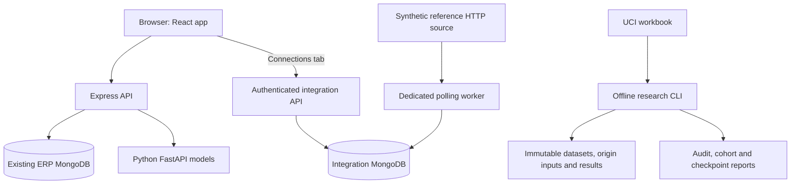
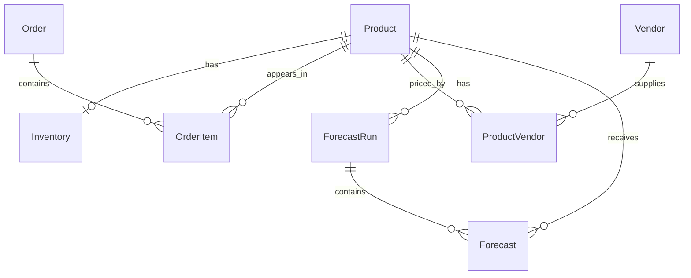

# SmartERP AI — Complete Project Documentation

**Canonical project report and technical overview**

**Last reconciled with the repository:** November 7, 2026.

**Scope:** Current implementation, recorded verification, known limitations, and explicitly identified future work.

This document consolidates the useful content of the former `PROJECT_DOCUMENTATION.md` and `project_review.md`, correcting their outdated claims against the current source. It is the main reference for what SmartERP implements today. Specialized startup guides, research artifacts and implementation plans remain linked as supporting material. When a plan and this report differ, the source code and recorded run artifacts determine implemented behavior; plans describe future work.

## Contents

1. [Purpose and current state](#1-purpose-and-current-state)
2. [Architecture and data boundaries](#2-architecture-and-data-boundaries)
3. [Technology stack](#3-technology-stack)
4. [Repository structure](#4-repository-structure)
5. [Application screens](#5-application-screens)
6. [Product, vendor and order workflows](#6-product-vendor-and-order-workflows)
7. [CSV and Excel interoperability](#7-csv-and-excel-interoperability)
8. [Application forecasting pipeline](#8-application-forecasting-pipeline)
9. [Application inventory recommendations](#9-application-inventory-recommendations)
10. [Native model comparison](#10-native-model-comparison)
11. [Connections and source synchronization](#11-connections-and-source-synchronization)
12. [Research benchmark: deliveries A and B](#12-research-benchmark-deliveries-a-and-b)
13. [Database models and relationships](#13-database-models-and-relationships)
14. [API reference](#14-api-reference)
15. [Demo data generation](#15-demo-data-generation)
16. [Startup and configuration](#16-startup-and-configuration)
17. [Tests, reproducibility and CI](#17-tests-reproducibility-and-ci)
18. [Security and deployment boundaries](#18-security-and-deployment-boundaries)
19. [Known limitations and remaining work](#19-known-limitations-and-remaining-work)
20. [Project presentation and resume wording](#20-project-presentation-and-resume-wording)
21. [Document map and maintenance](#21-document-map-and-maintenance)

## 1. Purpose and current state

SmartERP AI is a full-stack inventory and sales-management application with a Python forecasting service, an experimental automatic data connection, and an offline reproducible forecasting benchmark.

Its intended workflow is to connect operational sales and stock information with forecasts and replenishment insights. The existing app manages products, suppliers, order records and stock. The new Connections tab demonstrates automatic ingestion without a daily spreadsheet upload. The research workflow establishes evidence for forecasting quality before claiming inventory improvements.

Three implemented workflows must be distinguished:

| Workflow | Implemented behavior | Boundary |
| --- | --- | --- |
| Original application | Catalog/vendor management, orders, inventory, spreadsheet exchange, 30-day Linear Regression forecasts and native-model comparisons | Existing evaluation/recommendation limitations still apply |
| Reference integration | Automatic ingestion of synthetic products, fulfillment quantities and source stock, with durable processing and business-scoped access | No working live-provider adapter or automatic merge into the original catalog |
| Offline research | Audited UCI data, frozen cohort, immutable origin inputs and reproducible 30-day seasonal-naive development evaluation | Moving average, research boosting, inventory-policy simulation and final-test scoring are not implemented |

This is a development/research project. The repository does not establish a production deployment, independent load certification, measured business savings or complete procurement automation.

## 2. Architecture and data boundaries



The primary application has three layers: React UI, Express business API and FastAPI computation. Reference integration adds a separate source process and worker. Research runs independently through a CLI; it is not another database-backed application service.

### Data ownership

- **ERP data:** the existing application uses `DATABASE_URL` through its original Prisma client.
- **Connection data:** its Prisma client uses `INTEGRATION_DATABASE_URL`, falling back to `DATABASE_URL` only when a separate URL is not supplied.
- **Quickstart:** `start.sh` provisions a local integration database and uses the existing `backend/.env` database setting for the original app when present. It does not migrate that existing database automatically.
- **No existing ERP setting:** the app can use the local database and initially have an empty catalog.
- **Source stock:** imported sales do not deduct it again. The authoritative balance already represents the source system's stock calculation.
- **Research:** raw data, snapshots and results are filesystem artifacts. The benchmark never calls the business API or modifies live inventory.

Source records, ERP orders and UCI invoice observations have different semantics. Current code does not silently treat them as interchangeable.

## 3. Technology stack

| Area | Technologies actually used |
| --- | --- |
| UI | React 19, TypeScript, Vite 6, Tailwind CSS 3, Recharts, Axios, React Context, Lucide icons |
| UI animation | CSS/React landing animation; Framer Motion loading components |
| Business API | Node.js, Express 5, TypeScript, controllers, services, Prisma 5 |
| Database | MongoDB provider in the active Prisma schema; cloud or local configuration |
| Input validation | Zod for product/vendor APIs and source contracts; Pydantic for ML requests |
| File exchange | Multer memory uploads, csv-parse and SheetJS/xlsx |
| Application ML | Python, FastAPI, pandas, NumPy, scikit-learn |
| Optional native ML | XGBoost, LightGBM, Prophet and PyTorch |
| Automation | Dedicated Node integration worker; opt-in node-cron demo generators |
| Research | Python standard library, openpyxl workbook processing, pinned research dependency profile |
| Verification | Node test runner through tsx, Python unittest, Playwright browser checks, GitHub Actions configuration |

Installed dependencies are not automatically implemented features. For example, TanStack Query is declared in `frontend/package.json`, but current fetching uses React state/effects and Axios. There is no separate repository class layer between services and Prisma. MongoDB is the active database; the old SQLite migration is historical.

Dependencies are recorded in the backend/frontend package manifests and pnpm lockfiles, `ml-service/requirements.txt`, optional ML requirements, and `experiments/requirements.txt`. Version numbers describe those files, not a promise of compatibility with every future runtime release.

## 4. Repository structure

```text
Ai-Inventory-Demand-Forecasting/
├── frontend/src/
│   ├── App.tsx                 # Landing page, sidebar and tab switching
│   ├── api.ts                  # Typed Axios calls; environment-based API URL
│   ├── ThemeContext.tsx        # Light/dark theme persistence
│   └── components/            # Dashboard, Products, Vendors, Inventory,
│                              # Orders, ForecastLab, Connections, landing/loaders
├── backend/
│   ├── prisma/schema.prisma   # Active MongoDB models and indexes
│   ├── src/app.ts             # Express setup, integration and original API gates
│   ├── src/index.ts           # Server bootstrap and opt-in demo cron bootstrap
│   ├── src/controllers/       # HTTP handlers
│   ├── src/services/          # Product/order/vendor/inventory/import/demo logic
│   ├── src/integrations/      # Contracts, separate client, collection/application API
│   ├── src/workers/           # Reference polling worker
│   ├── src/scripts/           # Workspace/token provisioning
│   └── tests/                 # Contract and database/API integration checks
├── ml-service/
│   ├── app.py                 # FastAPI request validation and model endpoints
│   ├── models.py              # Existing five native model implementations
│   └── tests/                 # ML service behavior tests
├── reference-source/
│   ├── server.ts              # Independent, persisted synthetic HTTP source
│   └── data/seed.json         # Synthetic initial product/sale/stock fixture
├── experiments/
│   ├── cli.py                 # Prepare, evaluate, verify, invariance, reproduce
│   ├── data.py                # Workbook audit and training-only cohort preparation
│   ├── forecasting.py         # Pure weekly seasonal-naive implementation
│   ├── evaluation.py          # Origins, eligibility, metrics, saved runs and replay
│   ├── artifacts.py           # Canonical JSON and atomic/checksummed publication
│   ├── configs/               # Explicit benchmark protocol
│   ├── sources/               # Pinned source checksum and attribution
│   ├── reports/               # Versioned audit, cohort, CSV and checkpoint evidence
│   ├── tests/                 # Small deterministic research fixtures
│   ├── data/raw/              # Downloaded workbook; ignored by Git
│   └── artifacts/             # Full immutable local runs; ignored by Git
├── scripts/                   # App launcher, isolated integration and browser tests
├── start.sh                   # Normal application startup
├── run-research.sh            # Separate research/reproduction command
├── START.md                   # Simple, ordered startup instructions
└── PROJECT_DOCUMENTATION.md   # This canonical overview
```

## 5. Application screens

The original animated landing page appears first. **Launch Dashboard** enters the familiar application; Connections is an additional sidebar tab, using a cable icon distinct from Forecasting Lab's chart icon. Normal navigation requires no workspace token.

| Screen | Current features |
| --- | --- |
| Dashboard | Stock/SKU/alert summaries, historical/forecast demand charts, model selection and comparative average MAE, low-stock indicators, explicit demo actions |
| Products | Product creation/edit/delete, vendor-price editing, search, category filter, paginated list, imports, CSV exports and templates |
| Vendors | Supplier profiles, product counts, editing/deletion guards, imports/exports/templates |
| Inventory | Stock cards, category/search filtering, forecast modal, formula-based replenishment insights and spreadsheet exchange |
| Orders | Paginated order history, line items, amounts, import/export/templates |
| Forecasting Lab | Product selection, native-model forecast overlays, visibility controls, comparison metrics, timing and unavailable-model notices |
| Connections | Token-scoped reference connection, collection status, processing issues, source product/stock information and eligible retries |

Theme preference is stored in localStorage. Page loading and modal states are implemented. Navigation is React state-based tab switching rather than a URL router.

Current app data fetching is ordinary HTTP. Dashboard requests recommendations and model comparisons per product; Inventory fetches recommendations per item. Connections refreshes approximately every five seconds while open. There is no implemented WebSocket/SSE stream, so “real-time” should not be interpreted as live server push.

The Orders screen is a transaction-history view, not a completed purchasing system. Its existing purchase-oriented wording does not establish supplier purchase-order execution. The Inventory add-product shortcut currently omits the vendor array required by the create-product schema and can be rejected; the Products workflow supplies vendor mappings.

## 6. Product, vendor and order workflows

### Products and suppliers

Products have names/categories, a related inventory record, order items, forecast records and vendor-price mappings. A product can have several vendors. `ProductVendor` uniquely identifies each product/vendor pair.

Product APIs support pagination, case-insensitive name search, category filtering and sorting, including current-stock sorting. Frontend search waits approximately 550 ms after typing before fetching. API sorting capability does not imply every sorting option has a separate visible UI control.

Product creation uses nested Prisma writes to initialize stock and vendor mappings. Zod checks names/categories, nonnegative integer initial stock and at least one positive-priced vendor mapping. Vendor creation/editing validates names and optional email. Vendor deletion is blocked while product mappings exist. Product deletion is blocked whenever order items reference it, not only for some defined active-order status; Order has no lifecycle status field.

Product vendor-map replacement is multi-step and is not one transaction around the entire delete/recreate sequence. Product deletion's cleanup does not explicitly remove ForecastRun records. Do not generalize transactional guarantees from order creation to every update/delete operation.

### Orders and stock

`OrderService.createOrder()` creates an order and line items, then decrements inventory for each item inside a Prisma transaction. This pairs order/stock changes as an all-or-nothing operation.

The normal order service currently values units at a fixed amount of 10 rather than applying vendor pricing. It has no sufficient-stock check and no uniform Zod quantity validation. Consequently, atomic writes do not guarantee nonnegative stock or prevent overselling. Order retrieval is paginated and includes product details.

```text
POST order → create order/lines → decrement stock → commit transaction
```

Reference integration never calls this order-placement service to apply imported source sales.

## 7. CSV and Excel interoperability

Products, vendors, orders and inventory each have upload, CSV export and sample-template endpoints. Uploads use Multer memory buffers; CSV uses csv-parse and spreadsheets use the workbook's first sheet through xlsx. Results report successful rows and row-specific errors.

| Domain | Import behavior |
| --- | --- |
| Products | Detects duplicate name/category keys within a file; finds/creates vendors; finds products by case-insensitive name; upserts supplier pricing or creates a default inventory record |
| Vendors | Finds existing vendors by case-insensitive name and updates supplied contact data, or creates them |
| Orders | Accepts dated quantities; can create a missing product; writes each order and stock decrement/upsert transactionally |
| Inventory | Finds/creates a product and upserts current stock, reorder level, safety stock and lead time |

Imported products normally receive defaults of stock 100, reorder 20 and safety stock 10. Different legacy import paths may initialize incomplete supplier relationships. Order amounts use provided amounts or fallback pricing; they are not a consistent accounting implementation.

Exports are generated CSV text responses, not Excel exports or a proven streaming implementation. Import checks differ by entity and are not full semantic validation. The original name-based import workflow is not equivalent to the stable external-ID reference connector and is not generally idempotent. Repeated order files can create repeated orders. A numeric zero stock can also be mishandled by the legacy `currentStock || stock` alias lookup; this remains a known import edge case.

## 8. Application forecasting pipeline

Source: [inventory service](backend/src/services/inventory.service.ts) and [FastAPI endpoints](ml-service/app.py).

1. Look for a product forecast run created within the last hour and reuse its stored daily predictions when present.
2. Otherwise fetch order items and aggregate quantities by UTC date.
3. Construct an inclusive lookback from 60 days ago through today: **61 calendar observations**.
4. Fill dates absent from the sales map with zero. This legacy behavior does not distinguish missing collection from genuine zero sales.
5. Require at least five positive-sales dates. Insufficient history raises an unavailable error; the former fixed five-units/day fallback has been removed.
6. Send the series to `POST /ml/forecast`.
7. Fit Linear Regression on a sequential day index and predict the following 30 days, clipping negatives to zero.
8. Store a ForecastRun and dated Forecast records; calculate recommendations and update the inventory reorder level.

FastAPI accepts 16–3,660 observations, validates dates and nonnegative quantities, sorts dates, and rejects duplicate dates or non-consecutive daily series. It does not fabricate a synthetic history for empty requests. Forecast failures produce HTTP 503 at the ML endpoint; the existing backend controller generally surfaces failures as HTTP 500.

The ML response includes product ID, model name, 30-day total, dated daily predictions and increasing/decreasing/stable trend. The ERP backend response supplies run ID, daily predictions, recommendations and history; it does not consistently forward every ML response field. Frontend components compute some display totals/trends when absent.

### Persistence, cache and history

The ML service fits on request and has no persisted model registry. The backend persists predictions. Reuse is based on run time, not a dataset checksum, so a sale/history correction does not immediately invalidate an otherwise recent run. Comparison requests do not use this one-hour forecast reuse.

The history endpoint retrieves stored predictions and derives actual daily quantities from order items; absent actuals are represented as null. The optional Forecast.actualDemand schema field is not evidence that a complete automatic actuals-reconciliation pipeline exists.

Forecast GET/recommendation GET endpoints can train models and write records. Opening existing app views can therefore cause computation and database writes. Moving this behavior to explicit jobs is planned, not complete.

## 9. Application inventory recommendations

The current application implements the following deterministic rules:

```text
averageDailyDemand = sum(next 30 daily predictions) / 30
reorderLevel = averageDailyDemand × (leadTime or default 7) + safetyStock
recommendedStock = reorderLevel + averageDailyDemand × 7
daysUntilStockout = floor(currentStock / averageDailyDemand)
```

Reorder and recommended-stock values are rounded upward; the reorder level is persisted. Zero forecast demand yields the legacy sentinel 999 days, not a statistically supported estimate. A configured lead time of zero falls back to seven because the implementation uses a truthy default.

Safety stock is a stored/configured quantity, not a statistically estimated service-level buffer. The formulas do not model inbound delivery dates, reservations, backorders, repeated procurement, minimum order constraints or uncertainty. They are decision-support estimates; the project does not implement purchase-order placement or establish achieved service levels.

The research plan's later simulator uses separately specified inventory accounting. Its corrected protection-period calendar must not be confused with the current application's average-demand heuristic.

## 10. Native model comparison

`POST /ml/compare` attempts these native implementations:

| Method | Current implementation |
| --- | --- |
| Linear Regression | scikit-learn trend regression |
| XGBoost | XGBRegressor, 50 trees, depth 4, learning rate 0.1 |
| LightGBM | LGBMRegressor, 50 trees, depth 4 |
| Prophet | Weekly seasonality enabled; yearly/daily seasonality disabled; no configured holiday calendar |
| LSTM | PyTorch single recurrent layer, hidden size 16, five-observation windows, standardization, Adam at 0.01, MSE loss, 40 epochs for validation/full-history fits |

Linear Regression works with the core dependency profile. Other methods require the optional packages. Missing dependencies or execution failures are reported in `unavailable_models`; no substitute is presented as the requested model. Fake TFT/TimesFM model slots and fabricated comparison metrics were removed.

Tree models use seven lags, shifted seven-day rolling mean/std and weekday/month/day-of-month calendar features. Early rows without lag context are dropped, rather than backward-filled from future observations. Future tree and LSTM predictions are recursive.

### Existing comparison protocol limitations

The implementation uses an approximately 80/20 chronological split. Tree validation features include observed earlier holdout quantities; LSTM validation also appends actual preceding validation values. This is closer to rolling one-step evaluation than forecasting an entire 30-day holdout from one cutoff. Validation lengths vary with input size.

The reported metrics are MAE, RMSE, a modified MAPE that replaces zero denominators by one, and R² with a constant-target fallback. The field `latency_ms` includes fitting and predictions and should be described as model execution time, not pure inference latency. Native neural model runs are not fully seeded for reproducible scientific comparison.

Forecasting Lab ranks returned methods by MAE and labels execution-time differences. The dashboard can average model MAE across products. These descriptive rankings do not prove a method is best on independent real-world data. Selecting a comparison model does not switch the operational recommendation path away from Linear Regression.

## 11. Connections and source synchronization

### What runs today

The synthetic reference service is an independent HTTP process with persisted JSON state. It provides a stable snapshot identifier, paginated records and explicit synthetic labeling. Its fixture has a product, three fulfilled units and 20 available stock. The server copies its seed only when its state file does not already exist.

The reference adapter supports products, fulfillment quantities and available-stock balances at one `default` location. Records require external IDs, positive integer revisions, event/update timestamps and strictly validated fields. Inventory balance IDs follow `externalProductId@default`. Unexpected fields are rejected.

No live Shopify/POS/accounting provider is implemented. [Provider assessment](docs/provider-capabilities.md) records Shopify as a documented-only candidate with account verification pending. A reference-shaped contract does not establish compatibility with that provider.

### Processing lifecycle

```text
source page → durable inbox → claim with lease → validate mapping/version
            → apply canonical product/fulfillment/stock → finalize inbox status
```

- Uniqueness is `(connection, resource, external ID, revision)`.
- Payload hashing distinguishes an exact repeat from a conflicting same-version record.
- Same-version conflicts are quarantined; arrival order is not silently accepted as truth.
- Newer authoritative integer revisions replace canonical values; older versions do not regress them.
- Unknown source products quarantine dependent records. A subsequent product application enables their reprocessing.
- Processing claims have ownership tokens and expiring leases, with transactionally paired canonical effects/status.
- Up to five claim attempts are allowed; expired exhausted work becomes a visible failure.
- The retry endpoint requeues eligible failed/unmapped records. Conflicting revisions require investigation and are not blindly retried.
- Source stock is written as a source balance. Fulfillments do not decrement it again.

Collection detects changing snapshots across pages and repeated cursors. Previously collected records remain durable after a later page fails, but the connection remains incomplete. The implementation polls the entire small reference snapshot; it does not yet offer provider-grade incremental checkpoints, historical backfill manifests, comprehensive deletion semantics or full reconciliation.

The worker defaults to 30-second polling when started manually; the one-command launcher configures three seconds. The Connections UI refreshes about every five seconds. These are polling intervals, not guaranteed end-to-end latency.

### Identity and access

An IntegrationBusiness has a high-entropy bearer token; only its SHA-256 hash is stored in the database. API scope comes from the token lookup, not a caller-supplied business ID. Connection ownership is checked before retry. The UI holds the token in component memory; a reload or leaving/reopening the tab can require it again.

`start.sh` creates/reuses a private local token under `.local/workspace-token`, provisions a workspace and connects the reference source. The separate provisioning CLI can create another workspace/token manually. This is a minimal administrator credential mechanism, not complete account membership, RBAC, token rotation or tenant isolation for the older ERP APIs.

Even when every reference record is applied, forecast readiness remains explicitly blocked: historical coverage and the integrated forecast pipeline are not established. Imported data is shown in Connections and is not yet merged into original Products/Orders/Inventory pages.

## 12. Research benchmark: deliveries A and B

The offline research path is deliberately distinct from the application's existing model menu and scores.

### Data source and audit

The first dataset is [UCI Online Retail II](https://archive.ics.uci.edu/dataset/502/online%2Bretail%2Bii), cited as Chen, D. (2012), DOI [10.24432/C5CG6D](https://doi.org/10.24432/C5CG6D), licensed CC BY 4.0. Source attribution is recorded with the pinned download checksum.

The completed audit recorded:

- 1,067,371 rows across two worksheets, covering December 2009–December 2011.
- Eight overlapping observed dates and 22,523 duplicate-looking cross-sheet rows.
- A deterministic rule: the last workbook sheet owns an overlapping calendar date; duplicate-looking rows within that owning sheet are retained.
- Separate cancellation, nonpositive-quantity, merchandise-pattern and missing-customer audit counts.
- No customer identifiers retained in prepared research observations.

The target is **`gross_invoiced_units`**, not verified shipment quantities or uncensored demand. Cancellation/negative lines are excluded from that positive target rather than subtracted from an earlier observation. Candidate merchandise identifiers follow the declared code pattern. Zero-price eligible unit lines are retained and flagged in audit counts. Missing customer IDs alone do not invalidate sales.

### Coverage and selection

A complete-extract assumption permits explicitly labeled zeros on dates without qualifying invoice rows, including source-wide empty dates listed in the audit. This does not establish product activity, stock availability or zero customer demand. Pre-first-training-observation and source-boundary dates are unknown. Explicit uncertainty overrides zeros; invalid quantities block their date, and invalid dates with no defensible scope block preparation.

The initial conservative preflight treating every source-empty date as unknown produced no eligible origins. The accepted research coverage assumption was recorded before scored baseline results were examined; operational missing-data rules were not silently relaxed.

The frozen cohort has 20 products selected from 2,490 eligible initial-training series, five per training zero-frequency quartile, using a fixed seed. Future performance and later zero-sales periods do not decide membership. Training observations use a fixed 84-calendar-day context with no imputation; seasonal naive requires seven consecutive known days.

### Periods and forecast evaluation

| Period | Role |
| --- | --- |
| 2009-12-01–2010-11-30 | Initial training and cohort selection |
| 2010-12-01–2011-05-31 | Development evaluation |
| 2011-06-01–2011-11-30 | Reserved final evaluation, currently locked |
| Terminal partial December | Excluded from the first protocol |

At 22 weekly origins per product, the weekly seasonal-naive baseline repeats the last observed week across all 30 future days. No future actuals become inputs inside that horizon. Unknown training excludes an origin; unknown labels preserve a valid forecast as unscored and exclude that whole origin from scores. Forecast availability and scored-origin fraction are separate outcomes.

Metrics include MAE, prediction-minus-actual bias, seasonal MASE scaled using training-only weekly differences, horizon bands and cumulative error. Zero-scale MASE is undefined with an explicit count/reason. Product means and separately defined volume weighting are both reported. Weekly origins overlap; the scores are descriptive and not independent significance tests.

### Recorded development checkpoint

| Measure | Recorded result |
| --- | ---: |
| Completed product/origin forecasts | 440 |
| Macro product MAE | 5.904015 units/day |
| Macro product signed bias | +0.237500 units/day |
| Macro product seasonal MASE | 1.362472 |
| Forecast availability under the declared research assumption | 100% |
| Scored origin fraction | 100% |
| Undefined MASE origins | 70 |
| Products with defined aggregate MASE | 18 of 20 |

These establish one baseline, not a claim that forecasting is adequate for business use or that boosting improves it. Some products have later all-zero sales and are retained. Their small/zero errors do not demonstrate demand estimation or known product discontinuation.

### Artifacts and reproduction

Canonical JSON, SHA-256 checksums and atomic publication preserve source identity, preparation settings, cohort, exact origin training observations, separate labels, predictions, timing, status and code/dependency provenance. Complete manifests are published after files are written. Identical-content immutable artifacts are reused; differing overwrite attempts are rejected. Verification detects altered artifacts and checks the recorded model implementation.

A second independent run reproduced predictions/metrics; replay used saved inputs without reopening the workbook. Future-observation mutation checks passed for an eligible origin in each of 20 products, with additional cutoff tests on fixtures. The knowledge basis is the published historical workbook; real received/applied revision history is unavailable and is not retrospectively invented.

Raw workbooks/full local runs are ignored by Git. The source pin, cohort, audit, protocol lock, checkpoint summary and product CSV are versioned under `experiments/`. The reproducibility command downloads and prepares the verified source when required.

Evidence: [checkpoint report](experiments/reports/CHECKPOINT_AB.md), [product table](experiments/reports/seasonal-naive-development-products.csv), [workbook audit](experiments/reports/workbook-audit-v1.json), [protocol lock](experiments/reports/protocol-lock-v1.json), [research guide](experiments/README.md).

Moving average, research gradient boosting, inventory-policy simulation, delayed/corrected-data experiments and research-result UI views remain future deliveries. The five application models do not imply five scientifically benchmarked research methods.

## 13. Database models and relationships

The active schema contains **14 models**: eight original ERP models and six reference integration models. String primary/foreign identifiers generally use MongoDB ObjectId annotations. There is no active SQLite database provider. Historical SQL migrations should not be treated as the current MongoDB setup procedure.

### Original ERP

| Model | Role and notable constraints |
| --- | --- |
| Product | Catalog identity/category; relates to inventory, vendor mappings, order items and forecasts |
| Order | Dated transaction header and total amount |
| OrderItem | Product quantity linked to an order |
| Vendor | Supplier identity and optional contact email |
| ProductVendor | Product/vendor pricing; unique product/vendor pair |
| Inventory | One record per product; stock, reorder level, safety stock and lead time |
| ForecastRun | Product/run timestamp, model version/name and notes |
| Forecast | Dated predicted quantity, optional actual quantity, run linkage; product/date index |



### Reference integration

| Model | Role and notable constraints |
| --- | --- |
| IntegrationBusiness | Workspace name/timezone and unique API-key hash |
| SourceConnection | Business-scoped reference adapter, collection flags/time/error; unique business/adapter pair |
| SourceInbox | Durable payload/hash, source identity/revision, receipt/application timestamps, status/attempts/lease; unique connection/resource/entity/revision |
| SourceProduct | Business/connection product mapping and current source revision; unique connection/external ID |
| SourceFulfillment | Dated canonical shipped quantity mapped to a source product; unique connection/external ID |
| SourceStock | Current canonical source stock quantity/type/time/revision; unique connection/external ID |

Integration ownership is enforced in service/API logic; these collections do not define a full account-membership system or a general stock movement ledger. SourceInbox retains revision payloads, whereas SourceStock is a latest-balance read model. Research ForecastDataset/EvaluationRun contracts are currently file manifests, not additional Prisma models.

### Field inventory

The following fields are taken from the current [schema](backend/prisma/schema.prisma). `?` means optional, `[]` means a relation list. The schema itself defines defaults, ObjectId mappings, relations and indexes.

| Model | Fields and declared types |
| --- | --- |
| `Product` | `id: String`; `name: String`; `category: String`; `orderItems: OrderItem[]`; `inventory: Inventory?`; `vendors: ProductVendor[]`; `forecasts: Forecast[]`; `forecastRuns: ForecastRun[]`; `createdAt: DateTime?`; `updatedAt: DateTime?` |
| `Order` | `id: String`; `date: DateTime`; `totalAmount: Float`; `items: OrderItem[]` |
| `OrderItem` | `id: String`; `orderId: String`; `productId: String`; `quantity: Int`; `order: Order`; `product: Product` |
| `Vendor` | `id: String`; `name: String`; `contactEmail: String?`; `products: ProductVendor[]`; `createdAt: DateTime?` |
| `ProductVendor` | `id: String`; `productId: String`; `vendorId: String`; `price: Float`; `product: Product`; `vendor: Vendor` |
| `ForecastRun` | `id: String`; `productId: String`; `createdAt: DateTime`; `modelVersion: String`; `modelName: String`; `notes: String?`; `forecasts: Forecast[]`; `product: Product` |
| `Forecast` | `id: String`; `productId: String`; `forecastRunId: String`; `date: DateTime`; `predictedDemand: Float`; `actualDemand: Float?`; `createdAt: DateTime`; `product: Product`; `forecastRun: ForecastRun` |
| `Inventory` | `productId: String`; `currentStock: Int`; `reorderLevel: Float`; `safetyStock: Float`; `leadTime: Int`; `updatedAt: DateTime?`; `product: Product` |
| `IntegrationBusiness` | `id: String`; `name: String`; `timezone: String`; `apiKeyHash: String`; `createdAt: DateTime` |
| `SourceConnection` | `id: String`; `businessId: String`; `adapter: String`; `createdAt: DateTime`; `lastCollectedAt: DateTime?`; `lastError: String?`; `collectionComplete: Boolean` |
| `SourceInbox` | `id: String`; `businessId: String`; `connectionId: String`; `resource: String`; `externalId: String`; `revision: Int`; `payloadHash: String`; `payload: Json`; `occurredAt: DateTime`; `sourceUpdatedAt: DateTime`; `receivedAt: DateTime`; `appliedAt: DateTime?`; `status: String`; `error: String?`; `attempts: Int`; `leaseToken: String?`; `leaseUntil: DateTime?` |
| `SourceProduct` | `id: String`; `businessId: String`; `connectionId: String`; `externalId: String`; `name: String`; `sku: String?`; `revision: Int`; `sourceUpdatedAt: DateTime` |
| `SourceFulfillment` | `id: String`; `businessId: String`; `connectionId: String`; `externalId: String`; `productId: String`; `externalProductId: String`; `quantity: Int`; `occurredAt: DateTime`; `sourceUpdatedAt: DateTime`; `appliedAt: DateTime`; `revision: Int` |
| `SourceStock` | `id: String`; `businessId: String`; `connectionId: String`; `externalId: String`; `productId: String`; `externalProductId: String`; `quantity: Int`; `quantityType: String`; `occurredAt: DateTime`; `sourceUpdatedAt: DateTime`; `appliedAt: DateTime`; `revision: Int` |

## 14. API reference

The original routes have base prefix `/api`; integration routes use `/api/integrations`. There are 31 original ERP route registrations, three integration route registrations, and a separate backend health route. Request validation/HTTP errors are not uniformly exhaustive across the original APIs.

### Products

| Method | Path | Behavior |
| --- | --- | --- |
| GET | `/api/products` | List; page, limit, search, category, sortBy and sortOrder |
| GET | `/api/products/export` | Catalog CSV |
| GET | `/api/products/sample-file` | Import template |
| GET | `/api/products/:id` | Product, inventory and vendor mappings |
| POST | `/api/products` | Create product with inventory/vendor mappings |
| POST | `/api/products/import` | Multipart file import |
| PUT | `/api/products/:id` | Update catalog/vendor pricing |
| DELETE | `/api/products/:id` | Guarded deletion |

### Vendors

| Method | Path | Behavior |
| --- | --- | --- |
| GET | `/api/vendors` | Vendor list and product counts |
| GET | `/api/vendors/export` | Vendor CSV |
| GET | `/api/vendors/sample-file` | Import template |
| POST | `/api/vendors/import` | Multipart file import |
| GET | `/api/vendors/:id` | Vendor and mapped products |
| POST | `/api/vendors` | Create vendor |
| PUT | `/api/vendors/:id` | Edit vendor |
| DELETE | `/api/vendors/:id` | Delete when no product mappings exist |

### Orders, inventory and forecasts

| Method | Path | Behavior |
| --- | --- | --- |
| GET | `/api/orders` | Paginated transactions and product lines |
| GET | `/api/orders/export` | Order CSV |
| GET | `/api/orders/sample-file` | Import template |
| POST | `/api/orders/import` | Import orders and decrement stock |
| POST | `/api/orders` | Create transaction and decrement stock |
| GET | `/api/inventory` | Stock/product/vendor view |
| GET | `/api/inventory/export` | Stock CSV |
| GET | `/api/inventory/sample-file` | Import template |
| POST | `/api/inventory/import` | Upsert stock settings |
| GET | `/api/forecast?productId=...` | Reuse/generate application forecast; may write |
| GET | `/api/forecast/history?productId=...` | Stored predictions against order-derived actuals |
| GET | `/api/forecast/compare?productId=...` | Immediate native-model comparison |
| GET | `/api/recommendations?productId=...` | Forecast-based rules; may write |
| GET | `/api/forecast/seed-history?days=...` | Explicit synthetic-history utility |
| POST | `/api/simulate-data` | Destructive demo-data generation |

### Integration and ML

| Service | Method/path | Behavior |
| --- | --- | --- |
| Backend | `GET /health` | Backend liveness |
| Backend | `GET /api/integrations/status` | Token-scoped workspace, source state and issues |
| Backend | `POST /api/integrations/connections` | Create/reuse reference connection; body does not accept arbitrary URLs/credentials |
| Backend | `POST /api/integrations/connections/:id/retry` | Requeue eligible records after ownership check |
| FastAPI | `GET /health` | ML liveness |
| FastAPI | `POST /ml/forecast` | Linear Regression prediction |
| FastAPI | `POST /ml/compare` | Native comparisons plus unavailable-model list and protocol label |

FastAPI also exposes its generated `/docs` interface. The prior synthetic `GET /forecast` ML route is absent.

Missing/invalid integration credentials return 401, unknown/non-owned retry connections return 404, disabled reference creation returns 409, and original ERP APIs are denied with 403 outside their permitted development mode. Product/vendor validation commonly returns 400; many other backend failures return 500. FastAPI invalid inputs return 422.

## 15. Demo data generation

The original dashboard includes explicit synthetic utilities, distinct from the new inventory simulator planned for research.

### Sales-history generator

`SimulationService.simulateData()` deletes existing OrderItems, Orders and Forecast rows in the selected ERP database. It ensures example vendors/products when absent, then creates seasonal synthetic orders. This action can replace existing transaction history; it is not a harmless visualization refresh.

Its loop includes day zero through day 120: **121 calendar dates**, although the response calls it 120 days. Demand uses category baselines, an upward multiplier, a 1.3× weekend multiplier, a 1.8× December multiplier when applicable, and approximately ±10% multiplicative noise before rounding. Synthetic orders use a separate demonstration amount calculation and do not replay normal stock deductions. ForecastRun rows are not cleared by the same reset.

### Backdated forecasts

The history utility inserts synthetic ForecastRun/Forecast records based on a past-sales average with approximately ±5% variation, normally for 14 prior run dates. They are labeled `seeded-demo`. These are not genuine prospective forecasts or research holdout evidence.

### Opt-in cron

With `ENABLE_CRON=true`, `ENABLE_LEGACY_DEMO=true`, and a non-production environment, cron can create a random order every five minutes and a new product every hour. The one-command launcher sets cron false. These are synthetic activity generators, not scheduled external synchronization, forecast retraining or purchasing automation.

## 16. Startup and configuration

For simple ordered instructions, use [START.md](START.md). Run from the repository root:

```bash
bash start.sh
```

Open the printed URL and click **Launch Dashboard**. The normal app needs no token. Connections alone uses the token printed in that terminal. Ctrl+C stops app processes; the local database/data persist.

To run the separate offline research checkpoint:

```bash
bash run-research.sh
```

### Launcher behavior

The app launcher checks required tools, installs changed/missing Node dependencies, generates Prisma client code, prepares a dedicated MongoDB replica set, provisions/reuses a reference workspace, locates or prepares a Python environment, and starts ML, backend, frontend, source and worker processes. It preserves existing `.env` files.

Local integration schema setup targets the quickstart database. If an original database URL is configured, application reads and existing write actions still target that ERP database. The launcher does not automatically replace its historical data with synthetic transactions.

| Setting | Manual/default behavior | Quickstart behavior |
| --- | --- | --- |
| Node/Python tools | Node 22+, pnpm 10+, Docker running; Python 3.12+ recommended | Tools must already be installed; project dependencies are prepared |
| `DATABASE_URL` | Original ERP MongoDB URL | Existing `backend/.env` URL, explicit app override, or local fallback |
| `INTEGRATION_DATABASE_URL` | Separate integration URL; falls back if absent | Explicitly set to local integration database |
| Frontend | Vite typically 5173 | Chooses a nearby free port; prints actual URL |
| Backend `PORT` | 5000 if absent | Chooses nearby free port |
| `ML_SERVICE_URL` | Backend defaults to `http://127.0.0.1:8000` | Set to selected ML port |
| Reference source | Typically loopback port 5100 | Selected loopback port and local persisted source file |
| `REFERENCE_POLL_MS` | 30000 | 3000 |
| `ENABLE_REFERENCE_SOURCE` | Explicit opt-in | true, development-only |
| `ENABLE_LEGACY_DEMO` | Original ERP allowed locally unless explicitly false | true |
| `ENABLE_CRON` | Synthetic jobs require explicit true and other gates | false |
| `VITE_API_URL` | Environment override, otherwise development localhost or production `/api` | Actual selected backend origin |
| Quickstart database | Manual guide uses separate port 27120 example | Default container `smarterp-quickstart-mongo`, loopback 27121, database `smarterp_local` |

Advanced launcher overrides include `SMARTERP_APP_DATABASE_URL`, `SMARTERP_LOCAL_DIR` and `SMARTERP_LOCAL_DB_PORT`. Logs, a private workspace token, source state and dependency markers live under ignored `.local/`. Source state is seeded only on first creation. A source revision must increase when its canonical quantity changes.

Do not follow the historical SQLite `prisma migrate dev` instructions for the current MongoDB setup. Optional ML dependencies are in `ml-service/requirements-optional.txt`; the launcher does not install every optional deep-learning library automatically.

## 17. Tests, reproducibility and CI

The implementation records local passes for four backend contract tests, two transaction/API integration scenarios, six ML service tests and nine research tests, plus an end-to-end browser workflow. These counts describe the recorded implementation checkpoints, not a fresh run performed whenever this document is read.

Coverage includes source validation, canonical hashing, timezone grouping, duplicate effects, revision ordering, expired/exhausted leases, concurrent claims, partial pagination failures, token/business isolation, legacy UI navigation and source-stock preservation. ML checks reject fabricated/missing daily data and impersonated model fallbacks. Research fixtures check the 30-day weekly pattern, missingness, hand-calculated metrics, immutable artifacts, overlap/cohort behavior, replay, future-value safety, undefined MASE, and final-test lock.

Representative commands from the root:

```bash
pnpm --dir backend typecheck
pnpm --dir backend test
pnpm --dir frontend typecheck
pnpm --dir frontend build
bash scripts/test-integration.sh
```

Browser verification requires Chromium installed through frontend Playwright and runs with `RUN_BROWSER_TESTS=1 bash scripts/test-integration.sh`. The integration script creates an isolated loopback replica-set test database and removes its own temporary container.

For ML tests, activate the ML Python environment, enter `ml-service`, and run:

```bash
python -m unittest discover -s tests -v
```

For research tests, use the research dependencies and run **from the repository root**:

```bash
python -m unittest discover -s experiments/tests -v
```

The working directories matter because the ML tests import modules from `ml-service`.

GitHub Actions defines application, ML and research checks. Configuration alone is not evidence of a remotely observed successful run. A production frontend build has passed locally, with a large JavaScript chunk warning. Source/API/worker/ML browser smoke checks have passed; this is not a production load benchmark.

## 18. Security and deployment boundaries

Original ERP APIs have no complete user authentication/authorization. They are permitted locally unless explicitly disabled and blocked in production by the current application gate. This does not constitute a finished public authentication design.

Integration APIs use scoped high-entropy tokens and hashed storage. The reference source is operator-configured loopback HTTP only, requires explicit development opt-in, and rejects redirects/other destinations through the adapter. No arbitrary provider URL or external secret is accepted from the Connections form. Separate databases protect the existing app from reference-data application, but original ERP collections are not a complete multi-tenant design.

Environment files, tokens, logs, generated bytecode, raw research data and full local artifacts are excluded from tracking as appropriate. Existing local environment files are retained. No actual credentials belong in this report or shared screenshots.

`vercel.json` describes frontend/backend services and API rewrites. It does not deploy FastAPI, the persistent integration worker, MongoDB or research artifact storage. Production hosting still needs explicit worker/ML lifecycle, persistent storage, authentication, secrets, monitoring and operating policies. No working end-to-end public deployment is claimed here.

## 19. Known limitations and remaining work

### Existing limitations

- No sufficient-stock guard in ordinary order creation; no complete accounting/pricing model.
- Inconsistent validation and legacy import edge cases; name-based spreadsheet matching can merge or duplicate records incorrectly.
- Inventory add-product shortcut lacks required vendor data; some multi-step relationship edits/deletions need stronger consistency handling.
- Legacy UTC zero filling cannot distinguish absent ingestion from zero sales; today can be incomplete.
- One-hour forecast reuse ignores dataset revisions; GET requests can compute and write.
- Application holdout scores differ from the new 30-day research protocol; modified MAPE and constant-target handling need careful interpretation.
- Fixed/configured safety stock and average-demand heuristics do not establish optimized procurement or calibrated uncertainty.
- Connections is currently a synthetic, single-location full-snapshot demonstration; historical readiness remains blocked.
- No live-provider verification, full reconciliation, returns lifecycle, general movement ledger, incremental backfill protocol or automatic mapping-review workflow.
- Research A/B runs offline and is not yet connected to Forecasting Lab or Inventory analysis pages.
- No final-test score, research boosting/moving-average comparison, inventory outcome comparison, or measured business savings.

### Next research deliveries

1. Add moving average and lag-feature boosting using the same frozen cutoff/eligibility rules; finalize selection before unlocking the final test.
2. Implement inventory accounting with an explicit after-demand review calendar. With lead time seven and daily review, enumerate future days d+1 through d+7 under that event convention; test a shortage before the first receipt.
3. Compare shared-input policies separately from closed-loop policies learning from their own fulfilled sales.
4. Produce a reproducibility/limitations report as part of the A–D showcase release.
5. Add one delayed-record/correction experiment, distinguishing detectable gaps from silent omissions and using remaining calendar dates in stale-forecast fallback.
6. Extend broader fault/reconciliation tests, application result jobs/views and one real-provider demonstration when access exists.

Detailed future designs remain in [the research plan](FORECASTING_INVENTORY_EVALUATION_PLAN.md) and [integration plan](IMPLEMENTATION_PLAN.md). They must not be read as already implemented features.

## 20. Project presentation and resume wording

**Suggested title:** SmartERP AI — Inventory Management, Demand Forecasting and Reproducible Evaluation.

**One-line description:** A full-stack inventory application with a Python forecasting service, a durable reference-data integration, and a reproducible real-data forecasting benchmark.

Use achievement statements only for work you personally implemented or materially contributed to:

- Built a React/TypeScript inventory application with Express, Prisma/MongoDB and FastAPI, integrating product/vendor management, transactional order updates and 30-day forecasting.
- Implemented CSV/Excel imports, CSV reporting, catalog pagination/search and vendor-specific pricing relationships.
- Developed a reference ingestion workflow with durable inbox records, duplicate protection, revision-aware updates, worker lease recovery and token-scoped business access.
- Established a reproducible seasonal-naive benchmark across 20 training-selected products and 440 development forecast origins, preserving exact inputs and verifying independent replay and cutoff safety.

Do not claim native TFT/TimesFM, validated seven-model superiority, overselling prevention, 18.4% inventory savings, 99.9% service levels, foundation-model training, production scalability or live-provider compatibility. Those are not established by current implementation/evidence. Model/library use and personal engineering contribution should be stated separately.

## 21. Document map and maintenance

| Document | Role |
| --- | --- |
| **[PROJECT_DOCUMENTATION.md](PROJECT_DOCUMENTATION.md)** | Canonical detailed overview and current-status reference |
| [START.md](START.md) | Simple startup/stop/research commands |
| [Research checkpoint](experiments/reports/CHECKPOINT_AB.md) | Recorded development results, scope and artifact identities |
| [Research README](experiments/README.md) | CLI, coverage assumptions and replay details |
| [Research plan](FORECASTING_INVENTORY_EVALUATION_PLAN.md) | Accepted next research work and review clarifications |
| [Integration plan](IMPLEMENTATION_PLAN.md) | Broader design; current status must be checked against code and this report |
| [Reference integration guide](docs/reference-integration.md) | Detailed local operation and integration boundaries |
| [Provider assessment](docs/provider-capabilities.md) | Evidence status and outstanding real-account access |
| [RESUME_PROJECT_REPORT.md](RESUME_PROJECT_REPORT.md) | Earlier dated assessment; historical rather than authoritative for current behavior |
| Former `project_review.md` | Merged into this report and removed to avoid maintaining a duplicate overview |

Maintain this document when routes, models, dependency profiles, startup behavior or accepted experimental protocols change. Update benchmark numbers only from recorded run artifacts and state the evaluation partition. Preserve the distinction between implemented code, planned scope, synthetic demonstration and measured results.
