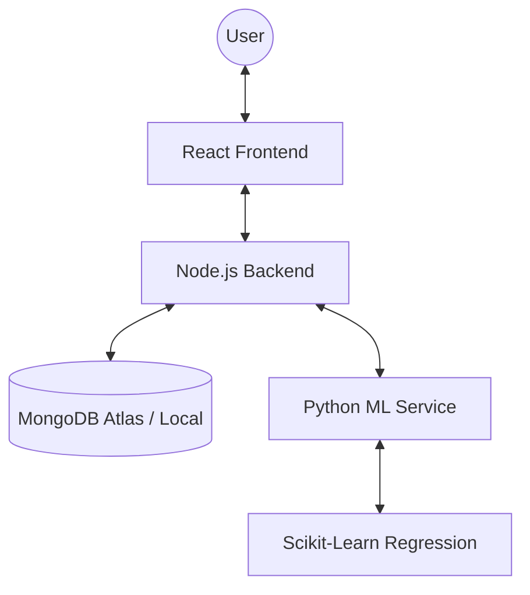

# 🚀 SmartERP AI - Intelligent Inventory & Demand Forecasting

This is a full-stack "Mini ERP" system that uses Machine Learning to optimize supply chain management. It doesn't just track stock; it predicts the future.

## 🏗️ Technical Architecture

The system follows a modern, decoupled architecture to separate business logic from heavy AI computation.



### 📂 Folder Structure

- **`backend/`**: Node.js & Express (TypeScript). Handles orders, inventory updates, and the data simulation engine. Powered by Prisma + MongoDB.
- **`frontend/`**: React 19 (TypeScript) & Vite. Provides a premium dark-mode dashboard with real-time charts.
- **`ml-service/`**: Python 3 & FastAPI. Performs time-series forecasting using Scikit-Learn.

---

## 🛠️ Key Features

1.  **AI Demand Forecasting**: Predicts next 30 days demand for every product.
2.  **Inventory Optimization**: Automatically calculates "Reorder Levels" and "Days Until Stockout."
3.  **Real-time Dashboard**: Interactive sales trends and inventory health visualization.
4.  **Automated Data Generation (Cron)**: Background workers automatically create orders every 5 minutes and new products every hour.
5.  **Data Simulation**: A built-in engine to generate 90 days of realistic sales history for immediate AI analysis.
6.  **Atomic Transactions**: Ensures inventory count is always accurate, even under high order volume.

---

## 🔄 How It Works (The Workflow)

1.  **Product Sync**: When you add a product, it's synced across the backend and initialized in the database.
2.  **Order Processing**: Placing an order triggers a transaction that checks stock and updates inventory in one go.
3.  **ML Integration**:
    - The Node.js backend pulls historical data from the SQLite DB.
    - It sends this data to the Python ML Service.
    - Python trains a Linear Regression model on-the-fly and returns predicted demand.
4.  **Operational Insights**: The frontend calculates reorder urgency based on current stock vs. predicted demand.

---

## 🚀 Getting Started

### 1. Prerequisites

- Node.js (v18+)
- Python (v3.9+)

### 2. Installation & Startup

#### Step A: ML Service (Python)

```bash
cd ml-service
python -m venv venv
source venv/bin/activate
pip install fastapi uvicorn pandas scikit-learn numpy requests
python -m uvicorn app:app --port 8000 --reload
```

#### Step B: Backend (Node.js)

```bash
cd backend
npm install
npx prisma generate
npx prisma migrate dev --name init
npm run dev
```

#### Step C: Frontend (React)

```bash
cd frontend
npm install
npm run dev
```

---

## 🧪 Testing the AI

Once all services are running:

1. Visit the **Dashboard**.
2. Click **Simulate Data** (Top Right).
3. The system will generate 90 days of sales history.
4. Visit the **Inventory** tab to see AI predictions and stockout risks.

<!----------------------------- Thanos --------------------------------->

We are using SQLite for the database.

## file : dev.db

to view the data use : "npx prisma studio" in backend folder
