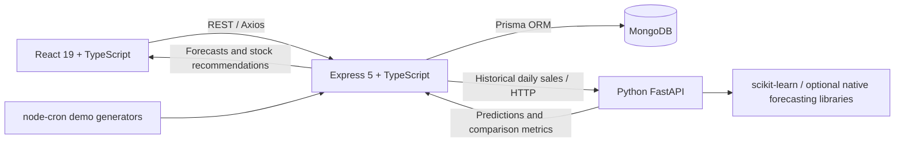

# SmartERP AI — Resume and Interview Report

Reviewed against the local source code on October 30, 2026. This report describes implemented capabilities, with runtime checks where stated. It does not establish individual authorship, production usage, deployment success, or business impact.

## Recommended positioning

**Project title:** SmartERP AI — Inventory Management and Demand Forecasting Platform

**Category:** Full-stack application with an integrated machine learning service.

**Overview:** SmartERP AI is a mini ERP application that connects product, vendor, order, and inventory management with product-level demand forecasting. A React and TypeScript interface communicates with an Express backend, which stores operational data through Prisma and MongoDB and sends historical sales to a separate Python FastAPI service. Forecasts support replenishment decisions through calculated reorder thresholds, recommended stock levels, and estimated days until stockout. A forecasting laboratory compares model outputs, validation errors, and execution times.

The strongest project story is the integration of an operational business workflow, a forecasting pipeline, persistent forecast records, and decision-support visualizations.

## Architecture and technology



| Area | Implemented technologies and responsibilities |
| --- | --- |
| Frontend | React 19, TypeScript, Vite 6, Tailwind CSS 3, Recharts, Axios, React Context, Lucide icons; Framer Motion in loading components |
| Business API | Node.js, Express 5, TypeScript; controllers, services, routes, environment-based configuration |
| Persistence | Prisma 5 with the active MongoDB provider; eight related schema models |
| ML service | Python, FastAPI, Pydantic, pandas, NumPy, scikit-learn; optional XGBoost, LightGBM, Prophet, and PyTorch |
| Data exchange | Multer in-memory uploads, csv-parse, SheetJS/xlsx, CSV downloads and templates |
| Validation | Zod for product and vendor API inputs; Pydantic for ML request structure; additional import-specific checks |
| Automation | node-cron for configurable demo order and product generation |

The active database schema is MongoDB. SQLite references and an old SQL migration describe an earlier state. TanStack Query is installed but the current UI uses React state/effects and Axios; it should not be advertised as implemented query caching.

The architecture separates the user interface, business API, and ML computation into three components communicating over HTTP. It demonstrates service separation; the repository does not establish independent production scaling.

## Implemented business capabilities

### Product catalog and supplier relationships

- Product creation, retrieval, editing, and deletion through REST endpoints.
- Initial inventory creation alongside a new product.
- Server-side pagination, case-insensitive name search, category filtering, and sorting, including sorting by inventory stock.
- A 550 ms debounced product search in the frontend.
- Multiple vendor-price mappings for each product, represented by ProductVendor.
- A unique product/vendor pair constraint to prevent duplicate mappings.
- Vendor profile management with contact email, associated product counts, and linked products.
- Deletion guards for products with order items and vendors with product associations.

These features demonstrate relationship modeling and operational CRUD beyond a simple forecast demonstration. Vendor pricing is stored, but the regular order creation path currently calculates amounts using a fixed price of 10 per unit.

### Orders and inventory consistency

An order contains one or more product line items. The regular order service creates the order and decrements corresponding inventory records inside a Prisma transaction. Imported orders also pair order creation and stock updates inside a transaction.

This is a strong resume point: **transactional order creation and inventory updates**. It provides all-or-nothing writes for those operations. The implementation does not check whether stock is sufficient before decrementing it, so it does not establish overselling prevention or guaranteed nonnegative stock.

Order retrieval supports pagination and includes product details for its line items.

### Bulk data interoperability

Products, vendors, orders, and inventory each support:

- CSV and Excel imports.
- CSV exports.
- Downloadable sample CSV templates.
- Import summaries with successful row counts and row-specific errors.

Product imports detect repeated product/category keys within a file, find or create vendors, and upsert product/vendor price mappings for existing products. Vendor imports update existing matching vendor records. Inventory imports can upsert stock records and their lead time, safety stock, and reorder configuration. Order imports accept historical dates and quantities and update inventory transactionally.

The useful business purpose is onboarding spreadsheet-based operational data and exporting records for reporting. Import validation is partial and varies by entity; avoid describing the import pipeline as fully validated or idempotent.

## Forecasting pipeline

### Operational forecasting

1. The backend reads a product's order items and their order dates.
2. Quantities are aggregated into UTC calendar-day totals.
3. Missing days receive zero demand to create a continuous series.
4. The lookback starts 60 days before today and includes today: 61 daily entries in the current loop.
5. If fewer than five days have positive sales, the backend returns a baseline of five units per day for the next 30 days.
6. Otherwise, the backend posts the historical series to FastAPI's `/ml/forecast` endpoint.
7. The Python service fits Linear Regression using a sequential day index and generates 30 future daily predictions, clipped to nonnegative values.
8. The backend stores a ForecastRun plus dated Forecast records and calculates inventory recommendations.
9. A recent stored run can be reused for one hour, avoiding repeated training and duplicate writes during that window.

The default replenishment path uses Linear Regression. Selecting another model in the comparison UI changes the displayed analysis; the code does not automatically promote the comparison winner into the inventory recommendation pipeline.

### Inventory decision support

The backend implements these calculations:

```text
Average daily demand = Sum of next 30 days' predictions / 30
Reorder level = Average daily demand × Lead time + Safety stock
Recommended stock = Reorder level + Average daily demand × 7
Days until stockout = floor(Current stock / Average daily demand)
```

Reorder and stock targets are rounded upward. The reorder level is persisted on the inventory record. Zero predicted demand returns a sentinel value of 999 days until stockout.

Safety stock is an input stored on the inventory record. The system does not estimate it statistically from demand variance or a service-level target. These are deterministic replenishment rules driven by demand forecasts.

### Forecast history

- ForecastRun stores execution time, model version, model name, and notes.
- Forecast records store product ID, run ID, forecast date, predicted demand, and an optional actual-demand field.
- A compound product/date index supports forecast lookups.
- The history endpoint joins predictions with actual quantities derived from orders.
- A separate demo utility creates backdated synthetic forecast runs for chart demonstrations. Those records are explicitly synthetic and should not be cited as prospective accuracy evidence.

## Model comparison laboratory

The shared forecasting pipeline implements an approximately 80/20 chronological train/validation split, computes MAE, RMSE, a zero-protected MAPE, and R², and records model execution time. That time includes fitting and validation/forecast prediction; describe it as execution time rather than pure inference latency.

The UI offers product selection, model visibility controls, historical and future demand charts, MAE-based rankings, fastest-model labels, and model status indicators. The dashboard also calculates average MAE across products for comparative display.

| Displayed model | Implementation and claim boundary |
| --- | --- |
| Linear Regression | Native scikit-learn linear trend model; also used by operational forecasting |
| XGBoost | Native XGBRegressor when available; scikit-learn GradientBoostingRegressor otherwise |
| LightGBM | Native LGBMRegressor when available; RandomForestRegressor otherwise |
| Prophet | Native Prophet with weekly seasonality when available; Ridge regression with weekly Fourier terms otherwise |
| LSTM | Native lightweight PyTorch LSTM when available; MLPRegressor otherwise |
| TFT | Always a substitute: median quantile GradientBoostingRegressor; no Temporal Fusion Transformer is implemented |
| TimesFM | Always a substitute: Ridge regression with lag features; no pretrained TimesFM model is loaded |

Tabular models use seven lag features, shifted seven-day rolling mean and standard deviation, and calendar features for weekday, month, and day. Future multi-day predictions are generated recursively by feeding predictions back into subsequent steps.

The native PyTorch implementation uses five-step windows, a single LSTM layer with 16 hidden units, a linear output layer, standardization, Adam optimization, and MSE loss. It trains for 40 epochs for validation and fits another model on full history for future prediction.

Important evaluation boundaries:

- Lag-model validation uses actual earlier validation observations as inputs; LSTM validation similarly feeds back actual observations. These are closer to rolling one-step evaluations than a fully recursive 30-day holdout evaluation.
- Initial missing lag values are backward-filled, allowing later values to populate early feature rows. This warrants review before treating the pipeline as leakage-free.
- MAPE replaces zero actual quantities with a denominator of one. It is a modified zero-handling convention.
- Exceptions can trigger alternative statistical models. If the entire Python comparison request fails, the backend returns simulated predictions and fixed comparison metrics.
- Ranking models does not establish that any particular one is best on an independent real-world dataset.

## Simulation and interface

The simulator generates roughly four months of sales using category-dependent baseline demand, an upward trend, a 1.3× weekend multiplier, a 1.8× December multiplier when December is in range, and approximately ±10% random variation before rounding. Its inclusive loop generates 121 calendar dates although the response calls it 120 days.

It can seed example vendors and products and resets existing orders and forecasts. It creates demonstration history, not an external benchmark dataset. It does not replay stock decrements through the normal order service.

Optional scheduled jobs generate a random order every five minutes and a product every hour. These demonstrate scheduled demo automation; they do not automatically retrain models, procure stock, or place purchase orders.

The interface includes a landing page and six main workspaces: Dashboard, Products, Vendors, Inventory, Orders, and Forecasting Lab. It presents historical versus predicted demand, stock health, replenishment thresholds, and model comparisons. React Context manages light/dark themes, persisted in localStorage. Loading indicators and modal workflows are implemented.

Data is fetched on component load or explicit refresh/actions. There is no implemented WebSocket or server-sent event stream supporting a claim of live push updates.

## Resume wording

Use the following first-person achievement wording only for work you personally implemented or materially contributed to.

**Recommended general software/full-stack entry**

**SmartERP AI — Inventory Management & Demand Forecasting**  
React, TypeScript, Node.js, Express, Python, FastAPI, MongoDB, Prisma, scikit-learn

- Built a full-stack inventory platform integrating product, vendor, and order management with a Python forecasting service generating 30-day product-demand predictions.
- Implemented transactional order and inventory updates, paginated catalog APIs, vendor-specific pricing relationships, and CSV/Excel imports with row-level error reporting across four business modules.
- Developed a forecasting pipeline with daily sales aggregation, missing-day zero filling, persisted forecast history, one-hour forecast reuse, and demand-based reorder and stockout calculations.
- Created interactive dashboards and a forecasting lab comparing model outputs, validation errors, and execution times using chronological holdout evaluation.

**Alternative ML-focused bullets**

- Engineered time-series features using seven demand lags, rolling statistics, and calendar variables, with recursive 30-day forecasting and nonnegative prediction constraints.
- Integrated Linear Regression, XGBoost, LightGBM, Prophet, and a PyTorch LSTM into a common forecasting interface with chronological validation, MAE/RMSE/MAPE/R² reporting, and dependency-aware fallbacks.
- Connected forecast outputs to replenishment rules using lead time, configured safety stock, recommended stock targets, and estimated stockout dates.

The second ML bullet describes implemented native integrations; reproducible setup needs optional model dependencies added to the installation process.

**Short two-bullet version**

- Built a React/TypeScript inventory platform with Express, Prisma/MongoDB, and a FastAPI service for 30-day demand forecasting and stock replenishment recommendations.
- Implemented transactional stock updates, CSV/Excel data exchange, forecast history, and interactive model comparisons with chronological validation metrics.

**One-sentence description**

Developed a full-stack inventory and demand forecasting platform that connects operational sales data to 30-day forecasts, replenishment recommendations, and interactive model evaluation.

## Defensible scope numbers

These describe code scope, not measured business impact:

- Three application components: frontend, business API, ML service.
- Eight Prisma schema models.
- 31 backend API route registrations, excluding the health endpoint.
- Four import/export domains: products, vendors, orders, inventory.
- 30-day forecasting horizon.
- Approximately 60-day historical lookback, currently 61 inclusive observations.
- Seven labeled comparison slots, including two permanently simulated substitutes.
- Five native model implementations successfully exercised in the local review environment.
- One-hour forecast reuse window.
- Approximately 120 days of synthetic history, currently 121 inclusive dates.

Prioritize the forecast horizon and meaningful workflows in a resume. Counts of models, routes, or schema entities can support scope but are less compelling than explaining behavior.

## Claims to avoid

- **18.4% lower safety stock / 99.9% service rate:** These appear as fixed frontend prose, with no supporting measurement or inventory experiment.
- **Implemented TFT or TimesFM / foundation-model forecasting:** Their classes run substitute scikit-learn algorithms.
- **Seven native models:** Five native implementations plus two substitutes exist; optional packages also affect runtime behavior.
- **Production-ready or proven scalable:** No production load, reliability, or deployment evidence was established.
- **Prevented overselling:** Transactions are present, but insufficient-stock checks are absent.
- **Automated purchase orders or procurement optimization:** Recommendations are displayed; purchasing is not implemented.
- **Live real-time streaming:** The UI uses HTTP fetches rather than push updates.
- **Best-model automated replenishment:** The operational recommendation path remains Linear Regression.
- **Real-world forecast accuracy or quantified business savings:** No independent benchmark or measured business outcome was established.
- **Docker, Kubernetes, CI/CD, RBAC, or automated test coverage:** Those capabilities were not found in the reviewed implementation.

## Validation performed during review

- Frontend production build: passed, with a warning about a JavaScript chunk larger than 500 kB.
- Frontend TypeScript check: passed using `tsc --noEmit --ignoreDeprecations 6.0`.
- Backend TypeScript check: failed with two TS2883 declaration portability errors involving inferred Express app and router types.
- ML service direct-call smoke test: generated 30 finite, nonnegative forecast values from an explicit synthetic 61-day series.
- Model comparison smoke test: all seven slots returned 30 finite, nonnegative values and finite metrics. Linear Regression, XGBoost, LightGBM, Prophet, and LSTM reported active; TFT and TimesFM reported simulated.
- The ML smoke test directly invoked service functions; it did not verify deployed HTTP connectivity or database-backed workflows.
- No application source changes, database modifications, simulation resets, or external deployment were performed during review. This report is the only intentional added source artifact.

The optional native libraries were importable in the existing local virtual environment. They are absent from `ml-service/requirements.txt`, so a fresh install from that file does not reproduce all native integrations.

## Interview explanation

“I built a mini ERP system that links operational inventory management with demand forecasting. The React frontend handles products, vendors, orders, stock visibility, and model comparisons. The Express backend manages MongoDB through Prisma and creates orders and stock updates within transactions. For forecasting, it aggregates sales into daily observations, fills missing days, and calls a separate FastAPI service to predict the next 30 days. Those predictions feed reorder thresholds and stockout estimates. I also built a comparison workflow for evaluating forecasting approaches using chronological validation, error metrics, and execution time. Some advanced model labels are explicitly simulated substitutes, while five native implementations are available.”

Adapt this to your actual contribution. Be ready to explain the transaction boundary, zero-filled data, 30-day horizon, chronological split, recursive predictions, fallback behavior, and why demo metrics do not prove business savings.

## Source map

- [Database models](backend/prisma/schema.prisma)
- [API routes](backend/src/routes/index.ts)
- [Forecast orchestration and recommendations](backend/src/services/inventory.service.ts)
- [Transactional order creation](backend/src/services/order.service.ts)
- [Product catalog service](backend/src/services/product.service.ts)
- [Vendor service](backend/src/services/vendor.service.ts)
- [CSV and Excel import/export](backend/src/services/import-export.service.ts)
- [Sales simulator](backend/src/services/simulation.service.ts)
- [Scheduled demo workers](backend/src/services/cron.service.ts)
- [ML endpoints](ml-service/app.py)
- [Model implementations and validation](ml-service/models.py)
- [Dashboard](frontend/src/components/Dashboard.tsx)
- [Forecasting Lab](frontend/src/components/ForecastLab.tsx)
- [Inventory UI](frontend/src/components/Inventory.tsx)
- [Theme persistence](frontend/src/ThemeContext.tsx)
